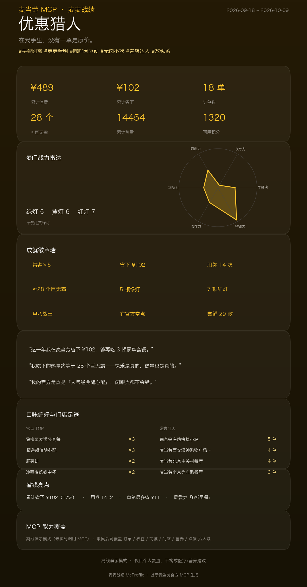

# McProfile · McDonald's Agent Skill

[中文](./README.md) | [English](./README_EN.md)

> **Find the most cost-effective order before you eat — then review every order you've ever eaten.**
>
> Tell your AI agent "I want a McChicken, how do I order it to save the most?" and it enumerates
> thousands of combinations, has each one **verified against the official McDonald's `calculate-price`
> API**, and returns an **S/A/B/C-rated optimal solution + a shareable report card** — all read-only,
> **no order is placed, not a single cent is spent**.
>
> After you eat, ask "how much did I spend and save at McDonald's, what's my McPersona" and every
> order becomes a **spend × savings × health × benefits** review + a McPersona card.
>
> And try "when do my coupons expire, will they make it to the next campaign?" — it tells you exactly
> which coupons won't survive until that day.

This is an **Agent Skill**: the "brain" is `SKILL.md`, whose instructions are read by your **host AI
agent**, which talks directly to the official McDonald's MCP (`mcd-mcp`, 20 read-only tools) to do all
the work. Which means:

- No need to **clone the repo**, install Python, or bring any model key;
- Read-only first: solving / preheating / archiving only call query tools — no coupon claiming, no
  lottery, no ordering;
- The only write operation, `create-order`, is an **optional ordering loop, off by default**, and
  requires explicit confirmation.

The repo also keeps a **reproducible implementation** (`src/` algorithm modules + `tests/` + sample
data) — the executable ground truth of the same logic (103 tests), which satisfies the contest's
"source code" requirement and lets judges/developers verify the algorithms line by line; **but you
don't need any of it to use this Skill.**

⭐ **Liked it? A star is the biggest support → [github.com/dengbin21/mcd-profile](https://github.com/dengbin21/mcd-profile)**



---

## Why it's different

| # | Selling point | Why it's different |
|---|---|---|
| 1 | **Prices verified by the official API, never guessed** | Enumeration and pricing are strictly separated: every candidate combo is sent to the official `calculate-price` to get the **real amount payable**; local estimation is used only for ranking — the architecture makes it impossible for the model to invent prices |
| 2 | **Optimal answer with a rating + an intuition comparison** | S/A/B/C ratings + a "your gut order vs. the algorithm's optimum" comparison of amount payable / average price: not just the answer, but "where your instinct lost, and what ¥0.4 extra buys you" |
| 3 | **Budget × calorie dual constraints** | One sentence satisfies both "stay under budget" and "stay under calorie limit"; calories are matched against the official nutrition database with honest coverage reporting — unmatchable items are treated as a lower bound, never wrongly killed |
| 4 | **Preheat desk: which coupons won't survive until the next campaign** | Coupon expiry × campaign calendar are **crossed**, and conflicts are *computed*, not copywritten — most savings Skills never cross these two datasets |
| 5 | **One closed loop: before eating → after eating** | A single `preheat → solve → eat → archive` timeline; every entry point hands you the "next step" command, no one gets stuck halfway |
| 6 | **Honest, reproducible claims** | 103 tests + offline samples that run and can be re-checked; read-only first, the only write `create-order` is off by default and needs explicit confirmation |

---

## Quick start (3 steps)

1. **Install this Skill into your AI agent** (any client that supports Skills + MCP, e.g. WorkBuddy /
   Codex): import this repo, or drop `SKILL.md` into your client's skills directory.
2. **Configure the official McDonald's MCP** (one-time): get a Token at
   **https://open.mcd.cn/mcp**, then add an entry to your client's MCP config (WorkBuddy
   `~/.workbuddy/mcp.json` example):

   ```json
   {
     "mcpServers": {
       "mcd-mcp": {
         "type": "streamablehttp",
         "url": "https://mcp.mcd.cn",
         "headers": { "Authorization": "Bearer <your-real-token>" }
       }
     }
   }
   ```

   ⚠️ The token must be real; restart the client and confirm `mcd-mcp` is connected (i.e. the tool
   list shows `calculate-price`).

3. **Just talk normally.** Once the host agent reads `SKILL.md` it knows which tools to call:

| You say | Which path |
|---|---|
| "How do I order this cheapest" / "I want X, how to save" | **McSolve**: `query-meals` + `calculate-price` ×30 verified orders |
| "When do my coupons expire" / "Will they survive the campaign" | **McPreheat**: `campaign-calendar` × coupon expiry |
| "How much did I spend/save at McDonald's" / "What's my McPersona" | **archive**: `order-list` → 6-dimension portrait + persona card |
| "Order me a…" | Ordering loop (dry-run by default, needs explicit confirmation) |

## The three signature plays

### ① McSolve · the "McOptimal" solver (before eating)

Treat the official `calculate-price` as a **price oracle** and call it repeatedly:

```
query-meals            full menu (with images and prices)
query-my-coupons       coupons you hold (with expiry)
query-store-coupons    store campaign coupons
available-coupons      claimable "McSave" coupons
        ↓   local pruning by coupon thresholds, enumerating candidate combos
calculate-price × 30   official price verification per order     ★ engine
list-nutrition-foods   nutrition for the optimal solution
```

- The primary metric is **savings rate**, not lowest amount payable — otherwise the solver degrades
  into "persuading you to order less";
- Local estimation is only for ranking; **the final price always comes from official verification**;
- Supports **budget × calorie dual constraints** (`--budget` caps payable, `--kcal` caps calories);
- Outputs "your gut order vs. algorithm optimum" comparison + S/A/B/C rating + report long-image.

### ② McPreheat · the preheat desk (before eating)

Cross the official campaign calendar with **your coupons' expiry dates**:

> 7 days until "Autumn limited-edition new product launch" — but you have 1 coupon expiring in
> 3 days. **That coupon won't survive until then.**

- Conflicts are **computed** (coupon expiry < campaign start), not copywritten;
- Outputs countdown + conflict list + readiness score S/A/B/C + preheat card.

### ③ archive · 6-dimension review + McPersona card (after eating)

Translate your order history into a personal profile you can read and share:

- Spend / Savings / Health / Habits / Benefits / Campaigns — **six portraits**;
- **McPersona** + one-of-a-kind themes (colors/badges/one-liners): the same profile renders a
  different poster for different people;
- Also outputs an **MCP tool coverage list**, making "how much MCP capability was used" visible.

## McDonald's MCP capabilities used (20 read-only + 1 optional write)

| Domain | Tools |
|---|---|
| Orders | `order-list`, `query-order` |
| Benefits | `query-my-account`, `query-my-coupons`, `query-my-prizes`, `query-lottery-info`, `available-coupons` |
| Mall | `mall-order-list`, `mall-order-detail`, `mall-points-products` |
| Scenario | `query-nearby-stores`, `delivery-query-addresses`, `delivery-query-stores`, `query-meals`, `query-meal-detail`, `query-store-coupons`, `calculate-price` |
| Marketing | `campaign-calendar`, `now-time-info` |
| Nutrition | `list-nutrition-foods` |
| **Ordering (optional write)** | `create-order` — only on explicit user confirmation |

> **Deliberately unused**: `cancel-order` / `mall-create-order` / `party-order-create` /
> `auto-bind-coupons` / `draw-lottery` / `delivery-create-address` etc.
> Detailed call flows, fields and business value: **[MCP_INTEGRATION.md](./MCP_INTEGRATION.md)**.

## Safety

- **Read-only first**: solving / preheating / archiving only call query tools; `calculate-price`
  verification places no order.
- **Ordering is the only write operation and is off by default**: no `create-order` before explicit
  confirmation — only a price preview; before placing an order, list store/items/amount payable;
  keep the `orderId` after a successful order so it can be reversed.
- **Honest scope**: `order-list` returns only the latest ~10 orders, positioned as "review" not
  "annual statement"; coupon redemption usually requires the coupon-bound product code (the official
  wallet API does not return it), so pricing follows the coupon price the official API auto-matches
  per account — this is explicitly disclosed in the online report.
- **Privacy**: the token lives only in your client's MCP config — never in logs, never in outputs.
- **Disclaimer**: conclusions are for personal review only, not medical or nutritional advice.

## Repo layout

```
mcd-profile/
├── SKILL.md                # Skill definition (the product itself: triggers / plays / tool mapping / safety)
├── README.md               # This doc (how to use) — Chinese
├── README_EN.md            # This doc — English
├── MCP_INTEGRATION.md      # McDonald's MCP integration (Server / Tool / call flows / business value)
├── CONTEST_DECLARATION.md  # Contest declaration (official text, unchanged)
├── workbuddy.md            # WorkBuddy dev conversation context (linked reward verification)
│
├── docs/                   # Demo assets (e.g. demo-card.png)
├── src/                    # ★ Reproducible implementation (contest "source code"; not needed to use the Skill)
│   ├── solver.py           #   McSolve: coupon rule parsing + combo enumeration + Top-30 verification + dual constraints
│   ├── preheat.py          #   McPreheat: campaign × coupon-expiry conflicts + readiness
│   ├── analysis.py         #   6-dimension portrait (spend/health/benefits/savings/habits/campaigns)
│   ├── persona.py          #   McPersona engine (with no-order fallback)
│   ├── theme.py            #   one-of-a-kind themes (persona → colors/badges/one-liners)
│   ├── archive.py          #   collect → analyze → persona aggregation
│   ├── sources.py          #   20 read-only tool collection + offline sample fallback
│   ├── models.py           #   domain models & parsing (orders/coupons/stores/pricing/cart)
│   ├── nutrition.py        #   nutrition database + 3-level product-name matching
│   ├── ordering.py         #   ordering loop (pick store → rich menu → price → guardrails → order → verify)
│   ├── order_text.py       #   ordering utterance parsing (pure functions)
│   ├── mcp_client.py       #   minimal MCP Streamable HTTP client
│   ├── textpack.py         #   copy layer (WorkBuddy in-the-loop + 3 guardrails)
│   ├── images.py           #   product image tools (download/inline, degrade gracefully)
│   └── report/             #   rendering: markdown / html / png / tokens (shared design)
├── tests/                  # 103 self-tests (coupon parsing/solving/preheating/persona/copy guardrails)
├── data/                   # anonymized samples (menu/orders/benefits/nutrition/campaigns)
└── requirements.txt        # deps for running the reproducible implementation
```

## License

MIT.

> Disclaimer: this is a personal contest entry and is not affiliated with McDonald's.
